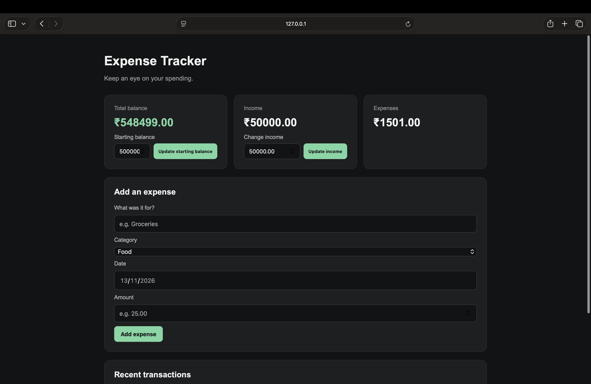

# Expense Tracker

A local web app for recording expenses and reviewing spending.

## Preview



## Features

- Add expenses with a name, category, amount, and date
- View expenses by month and see the monthly total
- Set an income amount and starting balance
- Calculate the remaining balance
- Delete expenses
- Save data locally with SQLite

The balance is calculated as:

`Starting balance + income - expenses`

## Built with

- Python
- Flask
- SQLite
- HTML and CSS

## Run locally

You’ll need Python 3 installed. From the project folder, open a terminal and run:

```bash
python3 -m venv venv
source venv/bin/activate
pip install Flask
python app.py